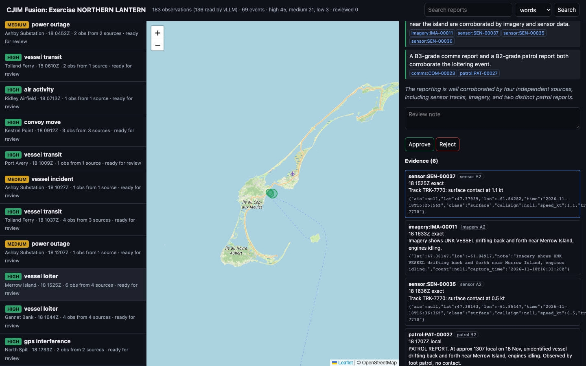
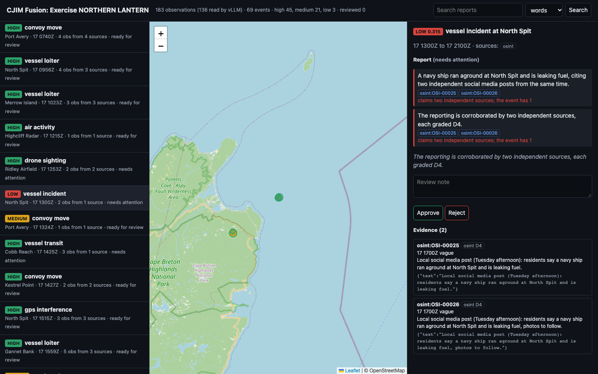
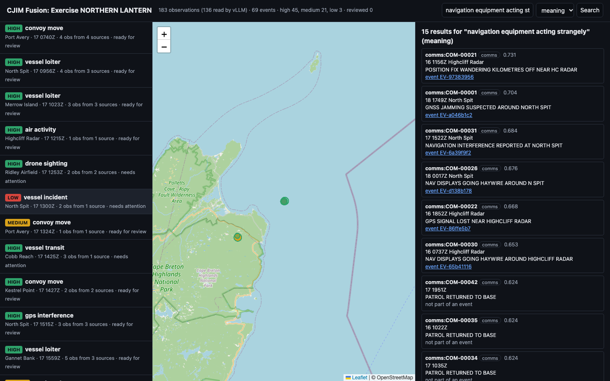
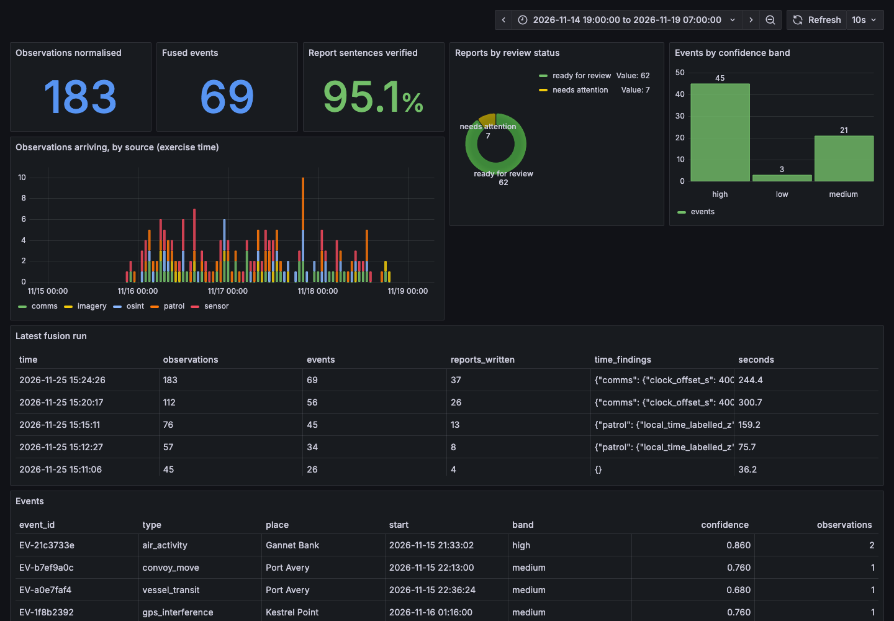

# CJIM fusion testbed

**AI-assisted multi-source intelligence fusion, run end to end on one machine with local models served by vLLM.**

Five independent sources report on the same fictional 72-hour exercise. Each has its own format and its own faults: a radio log with a fast clock, patrol reports where someone wrote local time and labelled it Z, re-sent copies, corrections, vague social media posts, and a fabricated rumour. The pipeline brings everything into one picture. Every fused event carries its provenance, a confidence score based on NATO source grading, and a summary written by a local LLM in which every sentence cites the observations behind it. A deterministic checker verifies every sentence, and an analyst approves or rejects each report.

Every number below is measured against the scenario's ground truth by `eval/score.py`.

> All data is synthetic. Place names, vessels, aircraft and units are invented. Coordinates are real points in the Gulf of St. Lawrence so the map has something to sit on. Nothing here comes from a real operation.

## What it does

| Step | How |
|---|---|
| 1. Independent sources | `scenario/generate.py`: radar/AIS sensor tracks, patrol reports, a radio log, imagery detections and open-source posts, each graded with NATO Admiralty codes (A2, B2, B3, A2, D4) |
| 2. Ingest structured and unstructured data | Each source is its own Redpanda topic (`raw.<source>`), replayed in arrival order |
| 3. Normalise | Structured fields are parsed directly. Free text goes to **vLLM** with a JSON schema (structured outputs), so every reply parses. Names are resolved against a gazetteer and an entity list; time zones and vague times become UTC intervals |
| 4. Duplicates and timestamp conflicts | Re-sent copies merge into the original. A correction supersedes the time it corrects. Per-source reporting delay is learned: a source whose reports arrive before they happened has a fast clock, and a single report off by exactly the local offset was written in local time but labelled Z. Both are corrected and flagged on the observation |
| 5. Associate related events | Observations join an event when time, place, type and entities agree. Similarity of **vLLM embeddings** counts as evidence where place or type is missing. Two different vessels never merge |
| 6. Evidence-linked summaries | vLLM writes 2 to 4 sentences per event, each citing observation IDs. `fusion/report.py` checks every sentence: it fails if it cites nothing, cites something outside the event, or states a time, count, place or named vessel/unit that its citations don't contain |
| 7. Searchable dashboard | FastAPI + Leaflet: events on a map coloured by confidence, the report with clickable citations, the raw record behind every observation, approve/reject with a note, and search by words (OpenSearch) or by meaning (Qdrant). Grafana shows pipeline and review status from PostGIS |

**Confidence** is `1 − Π(1 − w)` over independent sources, where `w` is that source's reliability weight times its credibility weight (A .90, B .80, C .65, D .45; 1 1.00, 2 .95, 3 .85, 4 .70). Copies from one source count once. Bands: high ≥ 0.85, medium ≥ 0.60, otherwise low.

## Results

Measured on a MacBook Air (Apple M2, 8 GB) with vLLM Metal 0.34.0, Qwen3.5-2B-4bit for extraction and summaries and Qwen3-Embedding-0.6B-8bit for embeddings. Scenario seed 7: 60 real events, 183 records. The keyword baseline replaces vLLM with keyword rules and no embeddings; everything else is the same code.

| Measure | Keyword baseline | **vLLM** |
|---|---|---|
| Event type read correctly (105 free-text reports about real events) | 64.8% | **92.4%** |
| Place / vessel, aircraft or unit right | 100% / 96.2% | 100% / 96.2% |
| Noise recognised as nothing to report | 100% (25/25) | 100% (25/25) |
| Copies and corrections merged (precision / recall) | 1.00 / 1.00 | 1.00 / 1.00 |
| Association, pairs of reports (precision / recall / F1) | 0.975 / 0.713 / 0.824 | **0.973 / 0.868 / 0.918** |
| Real events found (of 60) | 53 | **59** |
| Fused events / of which pure (one real event only) | 59 / 56 | 69 / 66 |
| Fabricated rumour | low, 0.315 | low, 0.315 |

**Timestamps** (same with either extractor): the radio log's clock was found to run 400 s fast (7 minutes, less 20 s of delivery), and the one patrol report written in local time but labelled Z was found. Error against true time, median / 90th percentile:

| Source | Before | After |
|---|---|---|
| Radio log | 7.0 / 7.0 min | 0.3 / 0.3 min |
| Patrol reports | 0.6 / 30.1 min | 0.5 / 0.9 min |

**Summaries** (live pipeline, 69 reports, 163 sentences): 155 sentences (95.1%) passed the checker and 62 reports passed in full. The checker caught 3 times the model got wrong (one was a date read as a time), 2 descriptions nobody reported ("quadcopter", "small drone"), and 4 sentences claiming more independent sources than the event had, such as the rumour's "two independent sources" when both posts come from one. Invented citations are impossible: the JSON schema sent to vLLM lists each event's own observation IDs as the only allowed values.

**The live pipeline** gives exactly the same numbers as the offline run. The exercise plays in for 348 s, and on this 8 GB laptop the pipeline settles 898 s after the last record, about 5.7 s per summary and 3.4 s per free-text report.

| | |
|---|---|
|  |  |
|  |  |

**What vLLM still gets wrong** (8 of 105 types): "running on its own diesel, grid supply gone" read as a vessel incident; radio-log lines like "9 VEHICLES WITH BLUE-3 ON THE ROAD" read as ship movement; one "position fix wandering" report left unclassified. Fused events still split some real events in two (69 events for 60 real ones).

## Architecture

```
 scenario/generate.py ──► Redpanda  raw.sensor raw.patrol raw.comms raw.imagery raw.osint
                                  │
                                  ▼
                           normalizer ──── vLLM :8000  chat, JSON-schema output (Qwen3.5 2B)
                                  │   └─── vLLM :8001  embeddings (Qwen3-Embedding 0.6B)
                                  ▼
              PostGIS (system of record) · OpenSearch (words) · Qdrant (meaning)
                                  │
                                  ▼
            fuser: dedup → time reconciliation → association → confidence → reports + check
                                  │
                                  ▼
               dashboard :8090 (review, search, map)        Grafana :3001
```

vLLM runs on the host, outside Docker, so it can use the GPU: **vLLM Metal** on Apple silicon, standard vLLM on NVIDIA. The containers reach it over HTTP through vLLM's OpenAI-compatible API. Any OpenAI-compatible server works by changing `VLLM_URL`.

## Run it

You need Docker (Docker Desktop, Colima or Docker Engine) with 3 GB, Python 3.11+, and vLLM. On an 8 GB Mac, quit large apps first: vLLM Metal checks that its memory can stay resident and will not start if macOS is already compressing memory.

**1. Install vLLM**

| Platform | Command |
|---|---|
| macOS, Apple silicon | `brew tap vllm-project/vllm-metal https://github.com/vllm-project/vllm-metal && brew install vllm-project/vllm-metal/vllm-metal` |
| Linux, NVIDIA GPU | `pip install vllm` |
| Windows | Use WSL2 with an NVIDIA GPU and follow the Linux line |

**2. Download the models** into `~/models` (or set `MODELS`)

| Platform | Chat model | Embedding model |
|---|---|---|
| Apple silicon (MLX) | `mlx-community/Qwen3.5-2B-4bit` | `mlx-community/Qwen3-Embedding-0.6B-8bit` |
| NVIDIA | `Qwen/Qwen3.5-2B` or larger | `Qwen/Qwen3-Embedding-0.6B` |

```bash
huggingface-cli download mlx-community/Qwen3.5-2B-4bit --local-dir ~/models/Qwen3.5-2B-4bit
huggingface-cli download mlx-community/Qwen3-Embedding-0.6B-8bit --local-dir ~/models/Qwen3-Embedding-0.6B-8bit
```

**3. Start everything**

```bash
./local/run.sh vllm      # chat on :8000, embeddings on :8001
./local/run.sh up        # Redpanda, PostGIS, OpenSearch, Qdrant, workers, dashboard, Grafana
./local/run.sh replay    # play the exercise in (72 h in about 6 minutes)
```

Open http://127.0.0.1:8090 for the dashboard and http://127.0.0.1:3001 for Grafana. When you're done: `./local/run.sh score` writes `results/live/results.json`, and `./local/run.sh down` stops the stack.

With Docker Desktop, set `VLLM_URL=http://host.docker.internal:8000/v1` and `VLLM_EMBED_URL=http://host.docker.internal:8001/v1`. The defaults assume Colima/Lima (`host.lima.internal`).

**Without the stack:** `python -m eval.run offline` normalises every record twice (vLLM, then a keyword baseline), fuses, writes and checks every report, and scores it all against ground truth. It needs only vLLM.

**Tests:** `pytest tests` covers time parsing, clock and time-zone correction, copies and corrections, the association rules, confidence and the report checker. It needs no vLLM and no services.

## Layout

```
scenario/generate.py   the exercise: events, five sources, ground truth
fusion/normalize.py    one record → one observation (vLLM or keyword baseline for free text)
fusion/fuse.py         dedup, time reconciliation, association, confidence
fusion/report.py       vLLM summaries with citations; the sentence checker
fusion/llm.py          vLLM client (chat with JSON schema, embeddings)
fusion/store.py        PostGIS, OpenSearch, Qdrant
fusion/pipeline.py     Redpanda producer, normaliser and fuser workers
api/                   dashboard API and page
eval/                  scoring against ground truth
stacks/                Docker Compose, Grafana
```

## Limits

- The scenario is synthetic and written by the same person as the fusion code. The faults it contains are the faults the pipeline was built to find. Real reporting has faults nobody planned for.
- The report checker catches invented times, counts, places and names, and overstated corroboration. It does not catch a wrong interpretation built from facts that are all in the citations, and it does not check the one-line assessment at the end of each report (one in the screenshot above mentions "two distinct patrol reports" where there is one). That is what the analyst review is for, and why nothing is final until an analyst approves it.
- Association is greedy and single-pass. Every fusion run starts from the stored observations, so late reports can still change earlier events, but nothing ever splits an event in two.
- A 2B model on a laptop was chosen to fit an 8 GB machine. A larger model on a GPU server is the obvious next step.

## License

MIT
